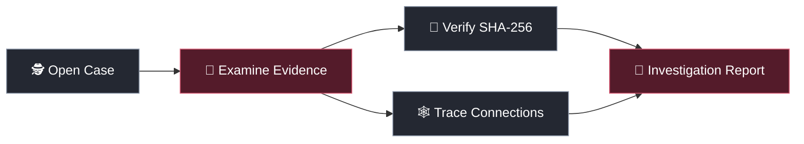

<div align="center">


### 🕵️ EVERY CLUE COUNTS. EVERY FILE LEAVES A TRACE.

**A detective-style digital investigation system built with Python and Data Structures & Algorithms.**

   

</div>

## 🚀 Run TRACE X

### 🌐 Option 1 — Try it online

**[▶ Launch TRACE X — Live Demo](https://trace-x-ztm7.onrender.com/)**

No installation needed. Open the website and sign in with a demo account below. The first visit may take a little longer if the Render service is asleep.

### 💻 Option 2 — Run it on your computer

Clone or download the GitHub repository, open its folder in a terminal, and run:

```bash
python -m venv .venv
# Windows: .venv\Scripts\activate
# macOS/Linux: source .venv/bin/activate
pip install -r requirements.txt
python run.py
```

Open **http://127.0.0.1:5000**. Sample cases and the database are prepared on first run.

### 🔑 Demo Logins — Pick Your Role

| Role | Username | Password |
|---|---|---|
| **Admin** | `admin` | `TraceX-Admin-2026` |
| **Amna · Detective** | `amna` | `TraceX-Detective-2026` |
| **Warisha · Detective** | `warisha` | `TraceX-Detective-2026` |
| **Hiba · Detective** | `hiba` | `TraceX-Detective-2026` |
| **Maryam · Detective** | `maryam` | `TraceX-Detective-2026` |


## 🔎 Welcome to TRACE X

What if your DSA algorithms could help investigate a case instead of just sorting numbers?

**TRACE X** is a digital detective workspace where investigators explore cases, check evidence, connect clues, and create reports. It **helps organize an investigation — it never decides who is guilty.**

### 🗂️ What's inside?

- **Case Files:** Suspects, witnesses, notes, and event timelines.
- **Evidence Vault:** Upload files and check if they've changed using **SHA-256**.
- **Custody Trail:** Follow the recorded history of evidence handling.
- **Clue Connections:** Explore links between people, devices, and evidence.
- **TRACE AI & Reports:** Get case-based assistance and generate PDF reports. AI requires a configured provider.
- **Detective & Admin Portals:** Detectives access assigned cases; admins manage the system.

## 🧠 DSA at Work

| DSA concept | What it does in TRACE X |
|---|---|
| **Linked List** | Tracks evidence custody events in order. |
| **Stack / Queue** | Undoes notes / processes tasks in first-in, first-out order. |
| **Hash Table** | Finds evidence quickly by ID. |
| **Tree** | Organizes evidence into folders and cases. |
| **Graph + BFS / DFS** | Connects clues and explores relationships. |
| **Merge Sort** | Puts investigation events in time order. |
| **Binary / Keyword Search** | Helps locate cases and useful records. |

**Bonus:** The **DSA Inspector** shows how these algorithms work using investigation data.

## 🧩 Follow the Clues




## 👥 The Technical Team Behind the Code

**Amna Fareed** · **Warisha Ahmed** · **Hiba Khan** · **Maryam Farhan**

*Semester 3 — Data Structures & Algorithms course project*

<div align="center">

---

**TRACE X — DON'T JUST FIND THE CLUE. FOLLOW THE TRACE.**

</div>
